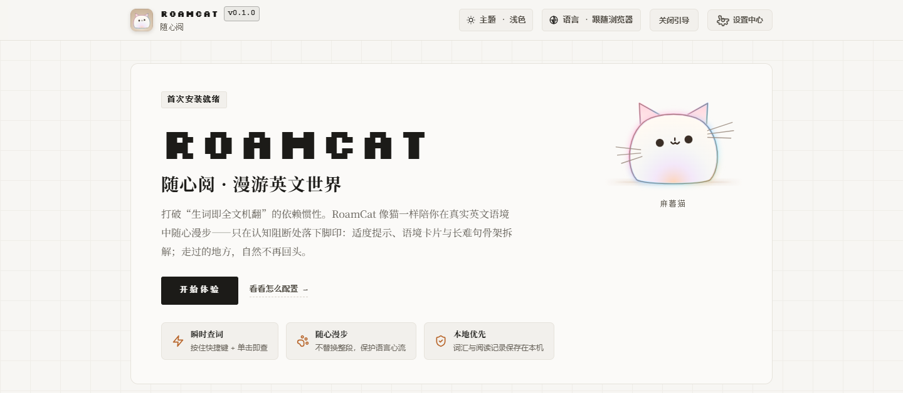
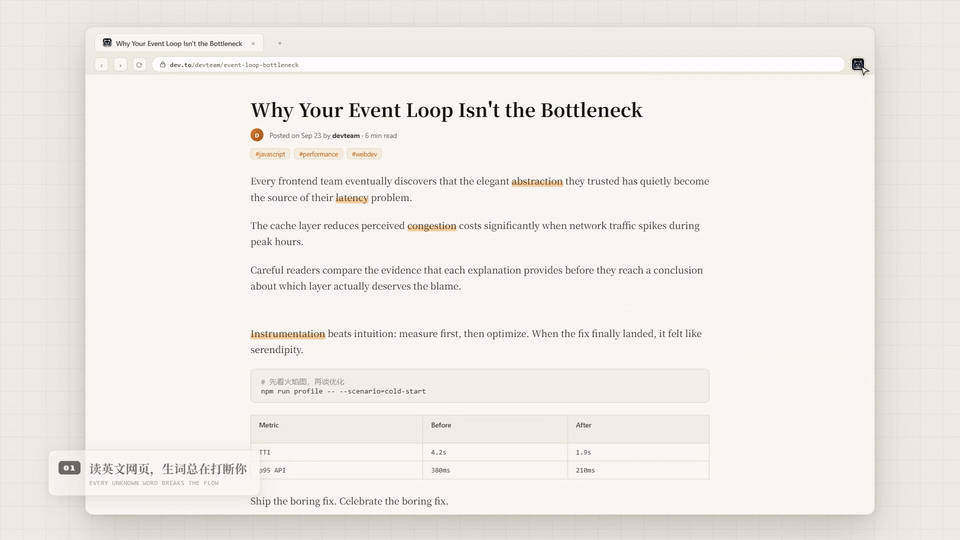
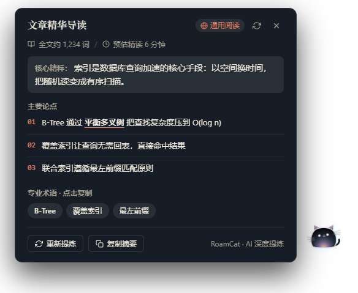
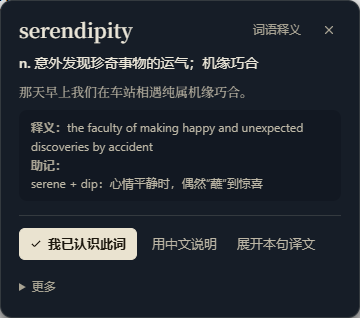
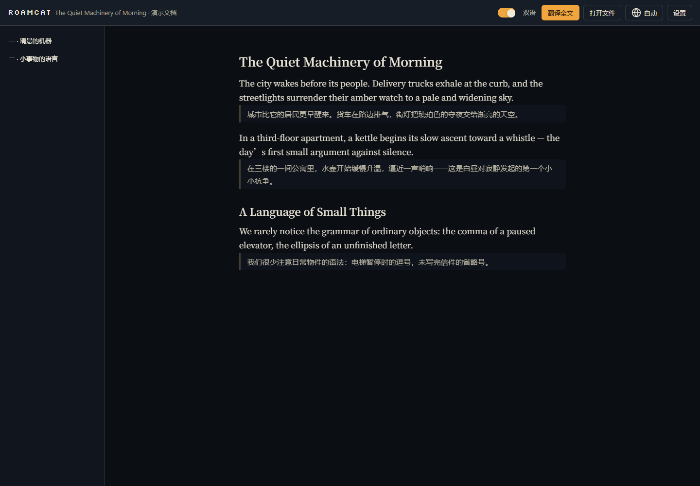
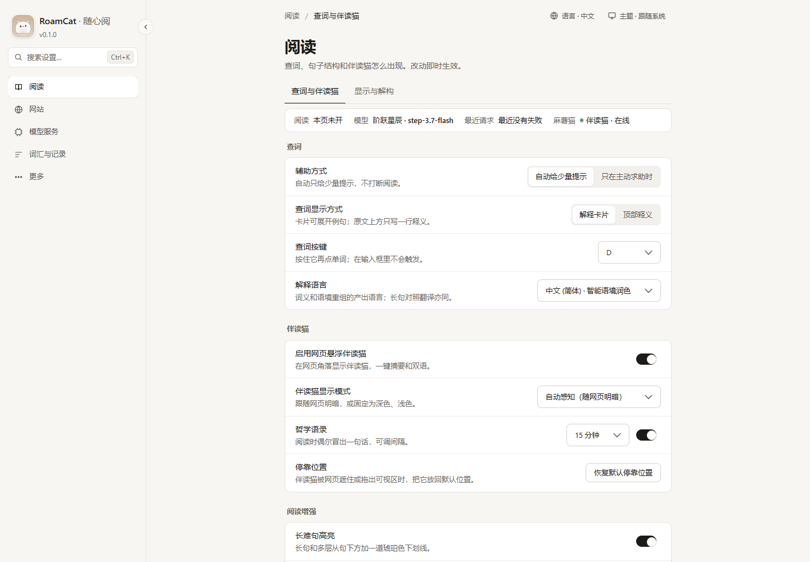
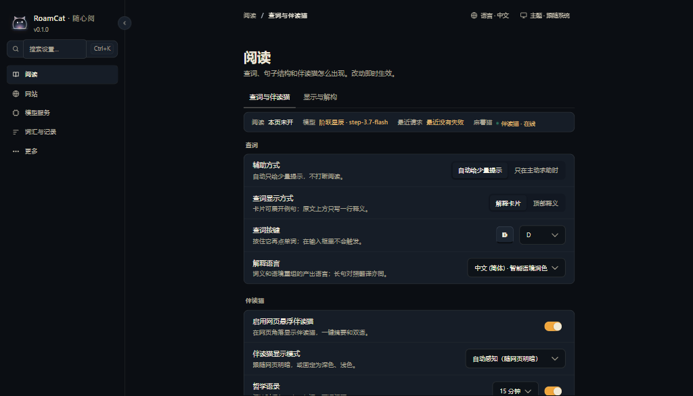
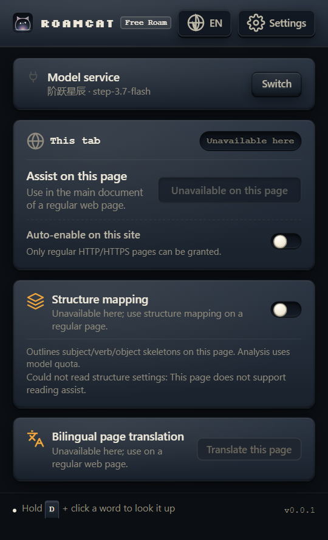

<p align="center">
  <picture>
    <source media="(prefers-color-scheme: dark)" srcset="roamcat-0.0.1/extension/icons/roamcat.svg">
    
  </picture>
</p>

<h1 align="center">RoamCat · 随心阅</h1>

<p align="center">
  <strong>Roam the English web like a cat — with help that knows when to step back.</strong><br>
  Bilingual mode lays Chinese beside every English paragraph.<br>
  Reading Assistance keeps the page English and only drops sparse hints that fade as you improve.
</p>

<p align="center">
  <a href="LICENSE"></a>
  <a href="https://github.com/dapao-777/roamcat/actions/workflows/ci.yml"></a>
  
  
  
</p>

<p align="center">
  <a href="#-quick-start"><b>Quick start</b></a> ·
  <a href="#-a-quick-tour">Tour</a> ·
  <a href="#-model-services">Model services</a> ·
  <a href="#-faq">FAQ</a> ·
  <a href="#-docs">Docs</a> ·
  <a href="README.zh-CN.md">中文</a>
</p>

<p align="center">
  <picture>
    <source media="(prefers-color-scheme: dark)" srcset=".github/assets/banner-welcome-dark.png">
    
  </picture>
</p>

<p align="center">
  <a href="https://github.com/dapao-777/roamcat/blob/main/.github/assets/roamcat-intro.mp4" title="Watch the 34-second intro film — with music">
    
  </a><br>
  <sub>▶ 34-second intro film · click the clip for the full video with music</sub>
</p>

> [!NOTE]
> **0.6.0 — cloud dictation for caption-less YouTube videos, plus a new Video & live settings group.** Download the package from [Releases](https://github.com/dapao-777/roamcat/releases/latest) or build from source, then load it in developer mode (see [Quick start](#-quick-start)); it is not on any extension store yet. RoamCat rebuilds, optimizes and repairs the open-source [RelyLess](https://github.com/rockythink/relyless) — see [Acknowledgements](#-acknowledgements).

## ✨ Highlights

- **Two modes, one engine** — side-by-side bilingual pages, or a reading assistant that keeps the original English in charge.
- **Reads real pages well** — site profiles for GitHub, Reddit, Hacker News, Stack Exchange, Discourse, dev.to and Lobsters keep code, diffs and vote chrome out of the way; formulas stay untouched.
- **PDF & EPUB reader** — the same bilingual engine for local files and pasted articles.
- **Your model, your choice** — 28 bring-your-own API providers, a bundled offline model, or a connector that reuses your ChatGPT / Grok / Google CLI subscription.
- **Local-first** — no RoamCat servers, no telemetry, reading history off by default and opt-in per site.
- **Fully bilingual UI** — every surface switches between Chinese and English, and a companion cat (with light and dark looks) keeps you company at the page edge.

## 🌓 Two modes, one engine

| | 🌐 Bilingual Translation · primary | 📖 Reading Assistance · secondary |
|---|---|---|
| **Does** | Translates page English in place into Chinese-English pairs | Keeps the English; sparse hints plus on-demand rescue only |
| **Invoke** | Popup "Translate this page" or `Alt+Shift+T` — follows your reading position, never pre-translates the whole article | Hints that taper off as you read; hold `D` + click to look up a word; select a passage for manual rescue |
| **Looks like** | Inline pairs in body text; tables and cards matched in place; navigation and sidebars get small inline translations | Lookup card, top-of-line glosses, sentence-structure underlines |
| **Exit** | "Back to English" removes only what the extension inserted | Hints fade as you read — the goal is to stop needing them |

Failed passages retry on a graded backoff (2.5s → 6s → 14s, classified by error code) before a manual "retry this passage" appears, so transient rate limits never flash failure UI.

## 📸 A quick tour

**The companion cat** perches at the page edge with the reading switch, an article digest, settings and shortcuts. It is draggable and dockable, one per page, never injected unless enabled — and it changes coat with the page: a rim-lit black mochi on dark sites, a cream mochi on light ones.

<p align="center">
  
  
</p>

**The built-in reader** opens PDF and EPUB files (or any pasted article); "Translate all" renders paragraph by paragraph at your reading position.

<p align="center">
  
</p>

**Settings and the toolbar popup** — status at a glance (reading, model, latest request), everything saved automatically, light and dark themes.

<p align="center">
  <picture>
    <source media="(prefers-color-scheme: dark)" srcset=".github/assets/options-dark.png">
    
  </picture>
</p>

<p align="center">
  
  
</p>

<details>
<summary><strong>More on reading real pages</strong></summary>

- **Site profiles** for developer haunts — GitHub, Reddit (old &amp; new), Hacker News, Stack Exchange, Discourse, dev.to (Forem), Lobsters: code blocks, diffs, file trees, vote and byline chrome stay out of reading blocks and translate as page furniture.
- **Long-sentence detection** flags ≥22-word sentences carrying subordinate clauses with a subtle amber underline — purely local, no model call.
- **Formula protection** keeps MathML / KaTeX / MathJax containers and inline `$…$` / `\(…\)` / `\[…\]` out of translation units.
- **Popup quick-switch** shows the active model service inline and swaps between subscription channels and saved APIs.
- **Twitch live-chat translation** (off by default): hit "Tr" by the chat input and new messages get a Simplified Chinese line underneath; emotes, one-word memes and Chinese messages are skipped. With an API service each tab sends at most 12 requests a minute, so busy channels can't drain your quota.

</details>

## 🔌 Model services

| Source | What you get |
|---|---|
| **Bring-your-own API** | 33 providers across 8 protocols — OpenAI / DeepSeek / Gemini / Anthropic / xAI / OpenRouter / Ollama / Alibaba Cloud / Volcano Engine / Kimi / StepFun and more. Structured output is probed first, then gracefully degraded. |
| **Subscription connector** | A local Native Messaging host reuses your official CLI entitlements — Codex CLI (ChatGPT), Grok CLI (SuperGrok / X Premium+), Antigravity `agy` (Google AI Pro / Ultra). No API key needed. |
| **Local model** | Bundled `Xenova/all-MiniLM-L6-v2` classifies page domains in an offscreen document — fully offline, nothing to download. |

## 🚀 Quick start

Requires **Chrome or Edge 125+**.

**Option A — Release package.** Download `roamcat-0.6.0-extension.zip` from [Releases](https://github.com/dapao-777/roamcat/releases/latest) and unzip it. Open `chrome://extensions` (or `edge://extensions`), turn on **Developer mode**, choose **Load unpacked** and pick the unzipped **`roamcat-0.6.0/extension`** folder. For the subscription connector, run `node roamcat-0.6.0/connector/install.mjs` from the directory containing `roamcat-0.6.0/` (Node.js 20.11+); it works out the extension ID from that folder, so rerun it if you move the folder.

**Option B — build from source** (Node.js 22.13+; Node 24 verified):

```sh
git clone https://github.com/dapao-777/roamcat.git
cd roamcat
npm ci
npm run build      # → dist/extension
```

Then open `chrome://extensions` (or `edge://extensions`), turn on **Developer mode**, choose **Load unpacked** and pick **`dist/extension`**.

The dev build pins its extension ID (`afpeggkplomdjjiemgajjgcajieincng`, from `build/extension-key.json`), so moving the folder never breaks the connector. After pulling new code, rerun `npm run build` and press reload on the extensions page.

**Optional — subscription connector.** Let the extension use the ChatGPT / Grok / Antigravity CLI you are already signed in to:

```sh
node roamcat-0.0.1/connector/install.mjs --extension-id afpeggkplomdjjiemgajjgcajieincng
```

One command registers every channel whose CLI is already installed (Codex, Grok, `agy`); missing CLIs are skipped. Pass `--backend grok` (or `chatgpt` / `antigravity`) to register only one.

The same command also installs a **local connector service** (listens only on `127.0.0.1:47821` and accepts only this extension ID) that starts at login. The extension connects to it first, so restarting the browser never needs a reinstall and the CLIs stay signed in; if the service is not running, the extension falls back to the browser connector. Add `--no-service` to skip it.

The service handshake requires a **pairing token**. Every install generates a fresh one in a directory only your OS user can read; the extension fetches it through the browser connector, so other accounts on the machine cannot get in by forging the extension's origin. This means the browser still needs the connector registration (Chrome and Edge are registered by default). **After upgrading from an earlier version, rerun the install command once to turn the token on**; until then the service keeps working as before. Right after reinstalling, the extension uses the browser connector for about a minute, then switches back to the service on its own.

## 🔒 Privacy by design

- Reading history is off by default and opt-in per site; nothing is collected on incognito pages; API keys live only in `chrome.storage.local`.
- Keys never reach content scripts, diagnostic logs or the connector; content scripts may send only **36 whitelisted message types** out of 77.
- All model output passes structured validation (`gloss.mjs`) before reaching the UI; custom API endpoints must be HTTPS (loopback excepted).
- Page text leaves your device only when you invoke a model feature, and goes straight to the provider you configured. Full details in the [privacy policy](roamcat-0.0.1/PRIVACY.md).

## ⚖️ How RoamCat compares

An honest look next to tools you may already know — RoamCat is not trying to be everything for everyone:

| | **RoamCat** | Immersive Translate | Relingo | 彩云小译 |
|---|---|---|---|---|
| **Approach** | Two modes: bilingual pairs *or* sparse assistance that keeps the original English primary | Full-page bilingual translation | Graded word highlights + look-ups | Page & selection translation |
| **Open source** | ✅ MPL-2.0 | ❌ closed | ❌ closed | ❌ closed |
| **Data path** | No vendor servers, no telemetry, history off by default | Text goes to the translation services you pick; vendor cloud features exist | Cloud account | Cloud service |
| **Model source** | 28 BYOK providers, a bundled local model, or reuse ChatGPT / Grok / Google CLI subscriptions | Built-in services + BYOK for select AI models | Built-in | Built-in |
| **Cost** | Free — you only pay your own API provider, if any | Freemium | Freemium | Freemium |
| **Platforms** | Chrome / Edge 125+ | Chrome, Edge, Firefox, Safari, mobile | Chrome, Edge | Chrome, Edge, apps |

If you want the most polished set-and-forget full-page translator on the most platforms, Immersive Translate is the mature choice. Pick RoamCat if you want the English original to stay in charge, want code you can audit, or would rather spend an AI subscription you already have than buy another one. Open-source neighbors worth a look: [kiss-translator](https://github.com/fishjar/kiss-translator) and [openai-translator](https://github.com/openai-translator/openai-translator).

## ❓ FAQ

<details>
<summary><strong>Is RoamCat free?</strong></summary>

Yes — MPL-2.0 open source, no accounts, no paid tier, no telemetry. You only pay if you connect a paid API yourself; the bundled local model and the subscription connector cost nothing extra.
</details>

<details>
<summary><strong>Does RoamCat send my reading data anywhere?</strong></summary>

There are no RoamCat servers. Reading history is off by default and opt-in per site; page text leaves the device only when you invoke a model feature, and goes directly to the provider you configured.
</details>

<details>
<summary><strong>Which browsers are supported?</strong></summary>

Chrome and Edge 125+ on desktop (Manifest V3). Firefox and Safari are not currently supported.
</details>

<details>
<summary><strong>Can it translate an entire page?</strong></summary>

Yes — Bilingual mode inserts Chinese next to each English paragraph as you read. Reading Assistance instead keeps the page fully English and adds sparse hints that fade over time.
</details>

<details>
<summary><strong>Does it work with PDFs and EPUBs?</strong></summary>

Yes — the built-in reader opens local PDF/EPUB files and pasted articles with the same bilingual engine.
</details>

<details>
<summary><strong>Which AI models can I use?</strong></summary>

28 bring-your-own providers (OpenAI, DeepSeek, Gemini, Anthropic, xAI, OpenRouter, Ollama, Alibaba Cloud, Volcano Engine, Kimi, StepFun…), a bundled local model for on-device domain classification, or a local connector that reuses your signed-in ChatGPT / Grok / Antigravity CLI subscription — no API key needed.
</details>

<details>
<summary><strong>Who is RoamCat for?</strong></summary>

Chinese-speaking readers who live on English sites — docs, GitHub, Reddit, Hacker News — and want help that fades as their reading improves, or side-by-side bilingual text when it doesn't.
</details>

## 🎨 Design language

**Paper &amp; ink × pixels × soft skeuomorphism.** Cream paper `#faf9f4` and warm ink `#161511`, the Silkscreen pixel font and a rim-lit mochi cat for a digital accent; controls are keycaps with physical feedback. The dark theme mirrors the same materials as **cool inkstone graphite** — canvas `#0b0e13`, ivory ink `#ece7d9`, porcelain primary keys, amber `#f0a63c` kept for semantic accents. Small text meets WCAG AA contrast in both themes.

<details>
<summary><strong>Design spec at a glance</strong></summary>

| Item | Spec |
|---|---|
| UI text | System sans (Segoe UI / PingFang SC / Microsoft YaHei), 14–15px |
| Reading text &amp; headings | Serif (Noto Serif SC → SimSun → Georgia), body 15px / 1.6 |
| Brand / digits / keycaps | Silkscreen pixel font (bundled woff2, works offline) |
| Palette | Paper `#faf9f4` + ink `#161511` in light; graphite `#0b0e13` + ivory `#ece7d9` + amber `#f0a63c` in dark |
| Logo &amp; mascot | Mochi cat in two coats — rim-lit black on an inkstone tile (`icons/roamcat.svg`) and cream on a latte tile (`icons/roamcat-light.svg`), plus a mono mark; all generated by `tools/make-brand-cat.mjs` |
| Motion | 80 / 160 / 280 / 440ms tiers + `linear()` spring curves, honors `prefers-reduced-motion` |

</details>

Every visual decision lives in one set of `--rc-*` tokens in `src/styles/tokens.css`; in-page widgets receive the same tokens through Shadow DOM and `design.js` without touching site styles. See the [design system](roamcat-0.0.1/docs/design-system.md), the [brand guidelines](roamcat-0.0.1/docs/brand.md) and the rendered [brand board](roamcat-0.0.1/docs/brand-board.html) (all in Chinese).

## 🏗️ Architecture

<details>
<summary><strong>Component map</strong></summary>

```
┌─────────────────────────────── browser ────────────────────────────────┐
│ Content scripts (nine static entries, document_idle)                   │
│   design.js → i18n-content.js → reading-style.js → content-ui.js →     │
│   pet-quotes.js → complexity.js → formula.js → site-profiles.js →      │
│   content.js                                                           │
│ Dynamically registered (chrome.scripting, on demand)                   │
│   · floating-pet.js companion cat · auto-start.js auto-enable          │
├────────────────────────────────────────────────────────────────────────┤
│ Service Worker: background.js (ES module, stateless)                   │
│   77 message routes · settings validation & migration ·                │
│   cache / concurrency / watchdog · subscription ports                  │
├────────────────────────────────────────────────────────────────────────┤
│ Extension pages: popup / options / welcome / reader                    │
│   Lit apps under src/, built by Vite into dist/extension/ui/           │
│ Offscreen document: local ONNX MiniLM domain classifier                │
├────────────────────────────────────────────────────────────────────────┤
│ Local connector (Node.js 20+, Native Messaging stdio)                  │
│   host.mjs + codex.mjs / grok.mjs / antigravity.mjs                    │
└────────────────────────────────────────────────────────────────────────┘
```

</details>

- **Trust boundary** — extension pages (trusted) → content scripts (33 whitelisted messages) → model output (validated before UI) → page DOM (enters prompts as data only).
- **One source of truth for the protocol** — `extension/message-protocol.js` registers all 77 message types with payload parsers; contract tests keep the router in sync.
- **One bilingual runtime** — `extension/i18n.js` holds 1,784 aligned zh/en keys shared by pages and the service worker; content scripts load the generated `i18n-content.js`, the same runtime trimmed to the namespaces web pages actually use.
- **Stateless service worker** — cross-call state lives in `chrome.storage` and IndexedDB; writes are serialized and long operations carry watchdogs.

The full engineering spec is in [`SPEC.md`](roamcat-0.0.1/SPEC.md) (Chinese).

## 🛠️ Development

| Command | What it does |
|---|---|
| `npm run build` · `npm run build:watch` | Dev build → `dist/extension` (fixed extension ID); watch rebuilds page UI, in-page UI, copied extension files and build config in sequence |
| `npm test` | Unit tests (`node --test` via `tools/run-unit-tests.mjs`; prints the current count) |
| `npm run verify` | Module-graph gates R1–R12: load contract, no cycles, layering, file headers, manifest resources, font-size scale |
| `npm run verify:build` | Build-artifact gates: byte comparison + real browser load smoke test |
| `npm run verify:ui` | 103-check UI sweep: every page and widget, light + dark, zh + en, screenshots → `preview/ui-audit/` |
| `npm run verify:pet` | 69-check companion-cat sweep: every floating button clicked for real |
| `npm run verify:sites` | Site-profile end-to-end checks against real-URL fixtures (`--live` rechecks real sites) |
| `npm run verify:options` | Settings-page behaviour checks (saving, rollback on failure, reset, model list) |
| `npm run verify:audit` | 30-check end-to-end audit: real background + local mock model in a real browser |
| `npm run build:release` · `node tools/package-release.mjs` | Release build (no dev key) → `dist/release/roamcat-<version>-extension.zip` + `SHA256SUMS` |
| `npm run gen:tokens` · `npm run gen:i18n` · `node tools/check-dict.cjs` | Regenerate `extension/design.js` from tokens · regenerate the content-script dictionary `extension/i18n-content.js` · zh/en dictionary parity |

Browser checks need a local [ego lite](https://lite.ego.app/) and Node.js 22+: `tools/lib/ego.mjs` starts its own headless ego with a throwaway profile and drives it over the Chrome DevTools Protocol (no Playwright). Set `ROAMCAT_EGO` to point at `ego.exe` if it is installed elsewhere. Please read [CONTRIBUTING.md](CONTRIBUTING.md) before contributing and report security issues privately per [SECURITY.md](SECURITY.md).

<details>
<summary><strong>Repository layout</strong></summary>

| Path | Contents |
|------|----------|
| [`roamcat-0.0.1/extension/`](roamcat-0.0.1/extension/) | Extension source layer: background, content scripts, `i18n.js`, domain modules, local inference, icons / fonts / `_locales`, and the `ui/` modules and styles shared by the page apps |
| [`roamcat-0.0.1/connector/`](roamcat-0.0.1/connector/) | Native Messaging host and the Codex / Grok / Antigravity adapters |
| [`src/`](src/) | Vite + Lit page apps and shared components; `src/content-ui` is the in-page lit-html layer |
| [`build/`](build/) | Build plugins, design-token generator and the dev extension key |
| [`tools/`](tools/) | Unit tests, static and browser gates, brand and promo generators |
| `dist/extension/` | Build output (not committed) — this is what you load in the browser |

</details>

## 🗺️ Roadmap

Planned directions — they may change with progress and feedback:

- One-click switching between the two modes while reading.
- Reading Assistance (sparse hints) inside the PDF/EPUB reader and on e-readers.
- Narrower permissions: `optional_host_permissions` requested on demand instead of all sites.
- Chrome Web Store and Microsoft Edge Add-ons listings (store copy ready in [`CHROMEWEBSTORE.md`](roamcat-0.0.1/CHROMEWEBSTORE.md)).

## 📖 Docs

| Doc | Contents |
|-----|----------|
| [Product docs](roamcat-0.0.1/README.md) (Chinese) | Features, installation, model-service setup, privacy notes |
| [Engineering spec](roamcat-0.0.1/SPEC.md) (Chinese) | Message protocol, storage model, security boundaries, test gates |
| [Design system](roamcat-0.0.1/docs/design-system.md) · [Brand guidelines](roamcat-0.0.1/docs/brand.md) · [Brand board](roamcat-0.0.1/docs/brand-board.html) (Chinese) | Tokens, typography, materials, motion, logo and mascot usage |
| [Privacy policy](roamcat-0.0.1/PRIVACY.md) | Data handling and permission usage |
| [Store checklist](roamcat-0.0.1/CHROMEWEBSTORE.md) (Chinese) | Store copy and per-permission justifications |
| [Changelog](CHANGELOG.md) | Version history (Keep a Changelog) |
| [Contributing](CONTRIBUTING.md) (Chinese) · [Code of conduct](CODE_OF_CONDUCT.md) · [Security policy](SECURITY.md) | Collaboration and disclosure |

## 🙏 Acknowledgements

RoamCat is a refactor of [RelyLess](https://github.com/rockythink/relyless): it rebuilds, optimizes and repairs that project on top of its open-source code and product ideas — the dual-mode engine, the Vite + Lit page build chain, whole-page bilingual translation and the subscription connector all grew from that foundation. Thanks to the original author, Bilibili creator **[停车拾穗](https://live.bilibili.com/392612)**. The upstream repository shipped without a license; this repository's own code is released under MPL-2.0, and this project will comply if upstream adds license terms.

## License

Original code is [MPL-2.0](LICENSE). Third-party assets — word-frequency data (CC BY-SA 4.0), models and runtimes (Apache-2.0 / MIT), icons (MIT) — keep their own licenses; see [NOTICE.txt](roamcat-0.0.1/NOTICE.txt).
